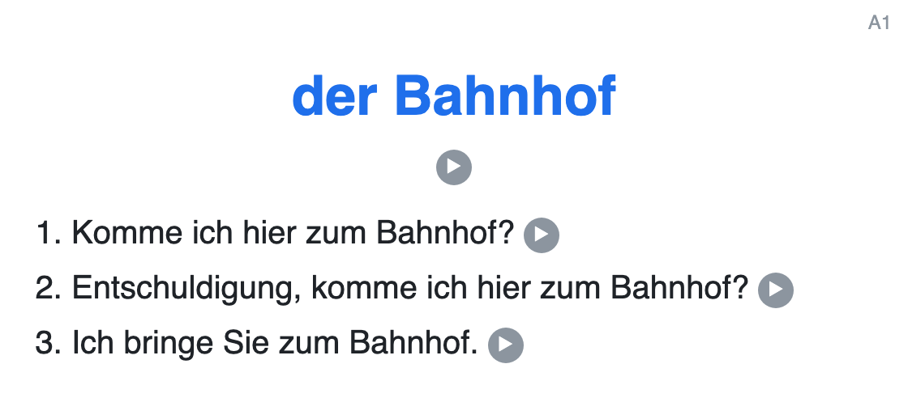
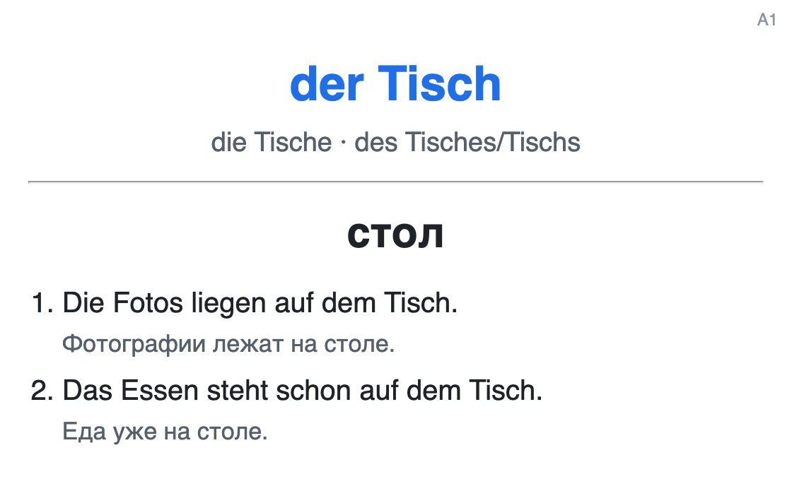
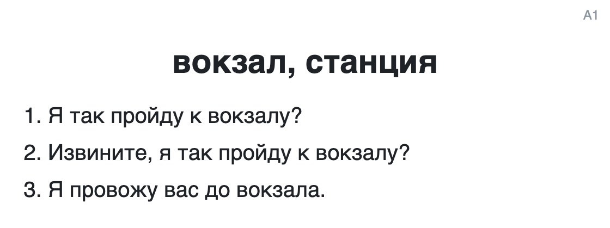
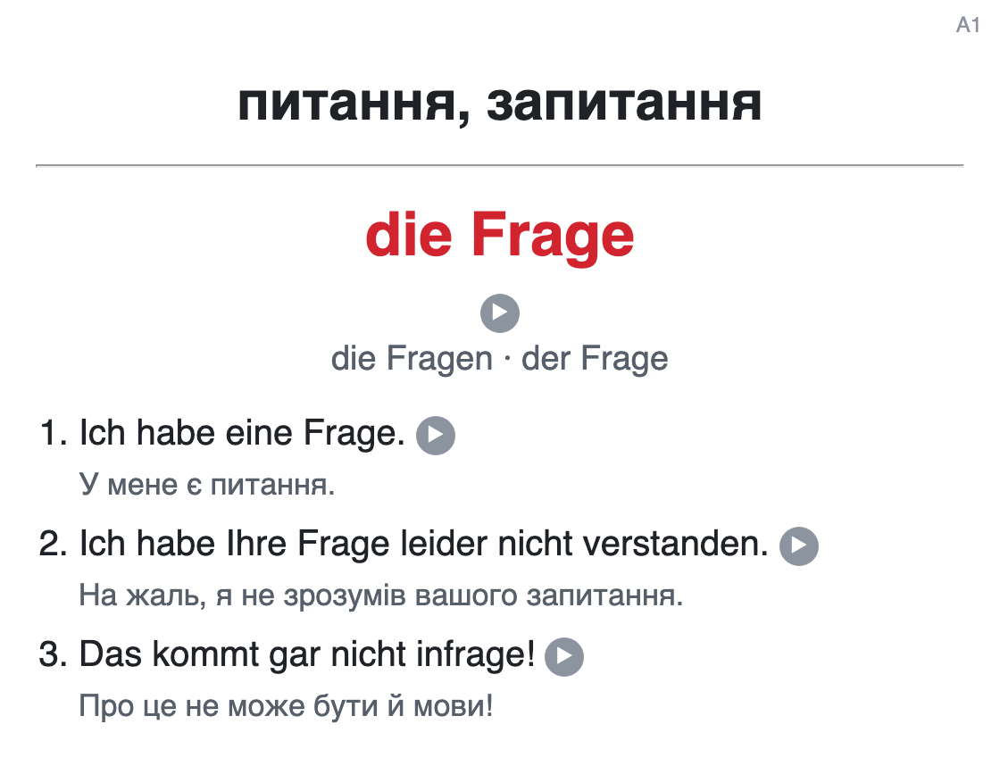
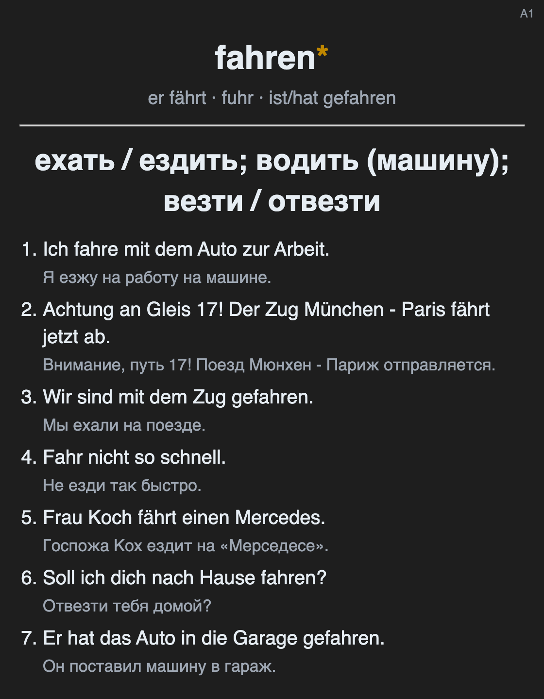
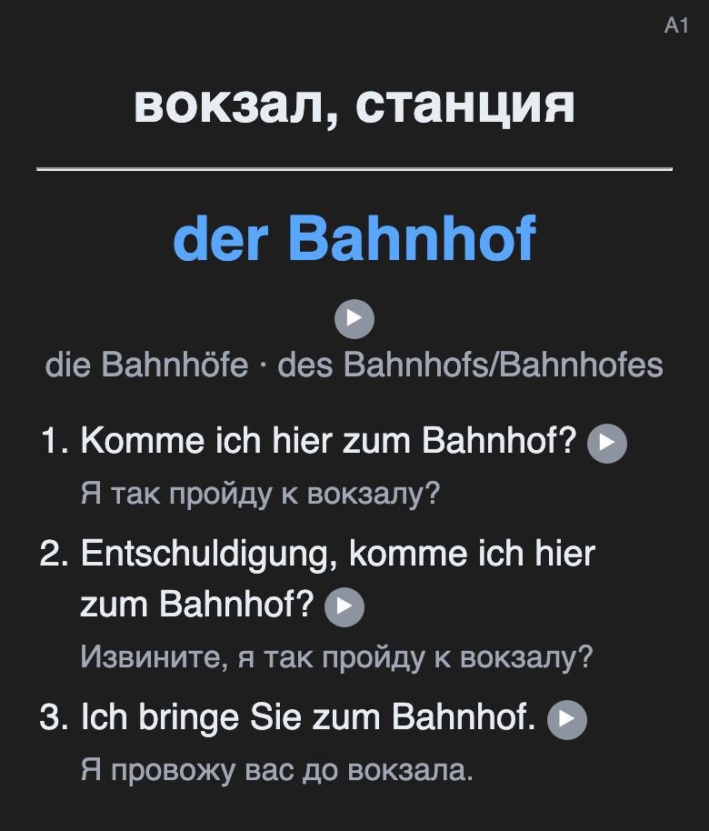

# Goethe A1–B1 Anki-Decks (DE ↔ RU / UK)

[English](README.md) · **Deutsch** · [Українська](README.uk.md) · [Русский](README.ru.md)

Anki-Decks mit dem vollständigen Wortschatz der offiziellen Wortlisten des Goethe-Instituts
([Start Deutsch 1 / A1][a1], [Goethe-Zertifikat A2][a2], [Goethe-Zertifikat B1][b1]):
Genusfarben, Plural, Genitiv, Verbformen und alle offiziellen Beispielsätze mit Übersetzung
und deutscher Audioaufnahme. Übersetzungssprachen: Russisch und Ukrainisch.

**⬇ [Neueste Version herunterladen](https://github.com/gemeinsam-deutsch-lernen/goethe-a1-b1-anki/releases/latest)** —
`Deutsch_Goethe_A1-B1_RU.apkg` (Russisch) · `Deutsch_Goethe_A1-B1_UK.apkg` (Ukrainisch).
Import: Anki → Datei → Importieren.

## Was ist Anki?

[Anki](https://apps.ankiweb.net/) ist eine kostenlose Karteikarten-App mit **verteilter Wiederholung**
(Spaced Repetition): Jede Karte kommt genau dann wieder, bevor man sie vergessen würde. So reichen
wenige Minuten am Tag, um Tausende Wörter dauerhaft zu behalten
([wie es funktioniert](https://docs.ankiweb.net/background.html)).

| Plattform | App | Preis |
|---|---|---|
| Windows, macOS, Linux | [Anki Desktop](https://apps.ankiweb.net/) | kostenlos |
| Android | [AnkiDroid](https://play.google.com/store/apps/details?id=com.ichi2.anki) ([F-Droid](https://f-droid.org/packages/com.ichi2.anki/)) | kostenlos |
| iPhone, iPad | [AnkiMobile](https://apps.apple.com/app/ankimobile-flashcards/id373493387) | kostenpflichtig (finanziert die Entwicklung von Anki) |
| Browser | [AnkiWeb](https://ankiweb.net/) — kostenlose Synchronisierung zwischen Geräten, Lernen im Browser | kostenlos |

Handbuch: <https://docs.ankiweb.net/>.

## Erste Schritte

1. Anki installieren (siehe oben).
2. `Deutsch_Goethe_A1-B1_RU.apkg` oder `Deutsch_Goethe_A1-B1_UK.apkg` aus der
   [neuesten Version](https://github.com/gemeinsam-deutsch-lernen/goethe-a1-b1-anki/releases/latest) herunterladen.
3. Datei öffnen: am Computer doppelklicken oder in Anki *Datei → Importieren*; unter Android/iOS mit
   AnkiDroid/AnkiMobile öffnen ([Decks importieren](https://docs.ankiweb.net/importing/packaged-decks.html)).
4. Optional: mit einem kostenlosen AnkiWeb-Konto synchronisieren, um auf allen Geräten zu lernen.
5. Das Tagespensum in den [Stapeloptionen](https://docs.ankiweb.net/deck-options.html) festlegen.
   Beispiel für **4 Wörter pro Tag** (ein Nomen, ein regelmäßiges Verb, ein starkes Verb, ein anderes Wort, jeweils in beide Richtungen):
   * Unterstapel `1 Nomen`, `2 Verben`, `2 Verben stark`, `3 Andere`: *Neue Karten/Tag* = 2, *Reihenfolge beim Sammeln neuer Karten* = Aufsteigende Position;
   * übergeordneter Stapel: *Neue Karten/Tag* = 8, *Reihenfolge beim Sammeln neuer Karten* = Stapel.

   Wer das Tempo für `2 Verben stark` getrennt einstellen will, gibt diesem Unterstapel eine eigene Optionsgruppe.

Neue Karten kommen in der Reihenfolge A1 → A2 → B1. Eine neuere Version kann gefahrlos importiert
werden: Der Lernfortschritt bleibt erhalten.

**Update von v0.1.3 oder älter:** Anki lässt vorhandene Karten in ihrem Stapel, die starken Verben bleiben also in
`2 Verben`. Einmalig verschieben: *Durchsuchen* → Suche `tag:verb::strong` → alle auswählen → *Karten → Stapel ändern* →
`2 Verben stark`.

## Screenshots

| Deutsch → Übersetzung (Vorderseite) | Deutsch → Übersetzung (Rückseite) |
|---|---|
|  |  |
| **Übersetzung → Deutsch (Vorderseite)** | **Ukrainisches Deck (Rückseite)** |
|  |  |
| **Verbformen, dunkler Modus** | **Smartphone, dunkler Modus** |
|  |  |

Die ▶-Schaltflächen spielen das Wort und jeden Beispielsatz auf Deutsch ab.

## Decks

| Datei | Deck | Übersetzung |
|---|---|---|
| `Deutsch_Goethe_A1-B1_RU.apkg` | `Deutsch Goethe A1–B1 (RU)` | Russisch |
| `Deutsch_Goethe_A1-B1_UK.apkg` | `Deutsch Goethe A1–B1 (UK)` | Ukrainisch |

Beide Decks haben denselben deutschen Inhalt und können parallel verwendet werden. Jedes Deck hat vier Unterstapel:

| Unterstapel | Inhalt |
|---|---|
| `1 Nomen` | Artikel + Nomen in Genusfarbe (**der** blau, **die** rot, **das** grün), Plural, Genitiv Singular, weibliche Form, regionale Varianten |
| `2 Verben` | regelmäßige Verben: Infinitiv, 3. Person Singular, Präteritum, `hat`/`ist` + Partizip II |
| `2 Verben stark` | starke/unregelmäßige Verben (`*`), dieselben Formen — eigener Unterstapel mit eigenem Tageslimit |
| `3 Andere` | Adjektive, Adverbien, Präpositionen, Wendungen, Wortbildungspräfixe |

Jede Notiz hat zwei Karten:

* **Übersetzung → DE** — vorne: übersetztes Wort + Übersetzungen aller Beispiele; hinten: deutsches Wort, Formen und Beispiele (DE + Übersetzung) mit Audio.
* **DE → Übersetzung** — vorne: deutsches Wort + deutsche Beispiele mit Audio; hinten: Formen, Übersetzung, Beispiele mit Übersetzungen.

Alle offiziellen Beispielsätze sind enthalten. Die deutsche Aussprache wird lokal mit
[Piper](https://github.com/OHF-Voice/piper1-gpl) (`de_DE-thorsten-low`) erzeugt und als MP3 gespeichert,
damit sie in Anki Desktop, AnkiDroid und AnkiMobile funktioniert.
Tags: `goethe`, `A1`/`A2`/`B1`, `pos::noun|verb|other`, `verb::strong`.

Die Übersetzungen sind maschinell unterstützt; Fehler bitte über [Issues](https://github.com/gemeinsam-deutsch-lernen/goethe-a1-b1-anki/issues) melden.

Selbst bauen und technische Details: siehe [Build](README.md#build) und [Pipeline](README.md#pipeline) (Englisch).

## Quellen und Lizenzen

**Wortschatz und Beispielsätze** — offizielle Wortlisten des Goethe-Institut e.V.
(Goethe-Institut e.V., Dachauer Straße 122, 80637 München):

| Niveau | Prüfung | Wortliste (PDF) |
|---|---|---|
| A1 | Goethe-Zertifikat A1: Start Deutsch 1 | [A1_SD1_Wortliste_02.pdf][a1] |
| A2 | Goethe-Zertifikat A2 | [Goethe-Zertifikat_A2_Wortliste.pdf][a2] |
| B1 | Goethe-Zertifikat B1 (Goethe-Institut, ÖSD, Universität Freiburg) | [Goethe-Zertifikat_B1_Wortliste.pdf][b1] |

Informationen zu den Prüfungen: <https://www.goethe.de/de/spr/prf.html>.
Die Wortlisten sind © Goethe-Institut e.V. Die PDFs sind nicht in diesem Repository gespeichert.
Die daraus entnommenen Stichwörter und Beispielsätze werden hier ausschließlich für nichtkommerzielles
Lernen verwendet. Wenn Sie Rechteinhaber sind und mit dieser Nutzung nicht einverstanden sind,
eröffnen Sie bitte ein Issue — das Material wird dann entfernt.

**Weitere Quellen**

* Grammatik (Genitiv, fehlende Plurale und Verbformen, Verbklasse): [Wiktionary](https://de.wiktionary.org/)
  über den [kaikki.org](https://kaikki.org/dictionary/German/)-Wiktextract-Export — CC BY-SA 4.0.
* Russische und ukrainische Übersetzungen: maschinell unterstützt, Teil dieses Projekts.
* Audio: [Piper TTS](https://github.com/OHF-Voice/piper1-gpl) (GPL-3.0), Stimme
  [`de_DE-thorsten-low`](https://huggingface.co/rhasspy/piper-voices/tree/main/de/de_DE/thorsten/low)
  von Thorsten Müller — CC0.

Dies ist ein inoffizielles, nichtkommerzielles Lernprojekt und steht in keiner Verbindung zum
Goethe-Institut und wird nicht von ihm unterstützt.

[a1]: https://www.goethe.de/pro/relaunch/prf/de/A1_SD1_Wortliste_02.pdf
[a2]: https://www.goethe.de/pro/relaunch/prf/de/Goethe-Zertifikat_A2_Wortliste.pdf
[b1]: https://www.goethe.de/pro/relaunch/prf/de/Goethe-Zertifikat_B1_Wortliste.pdf
