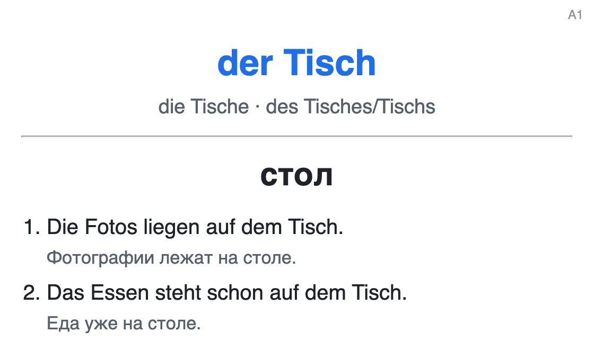
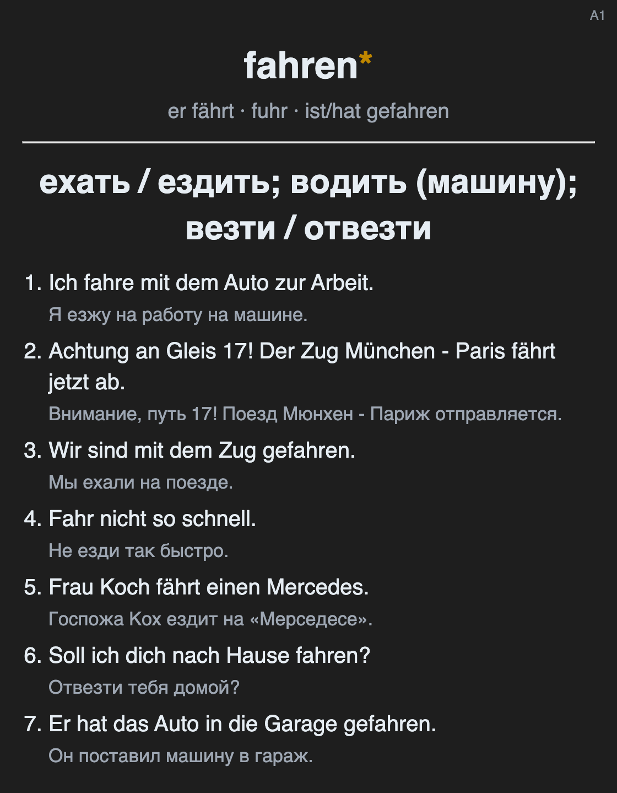
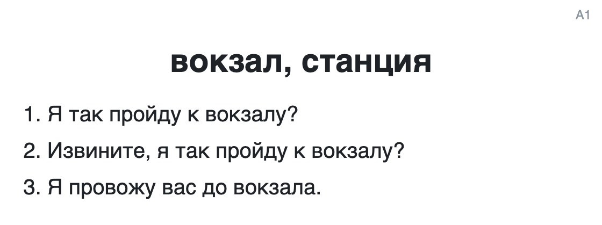
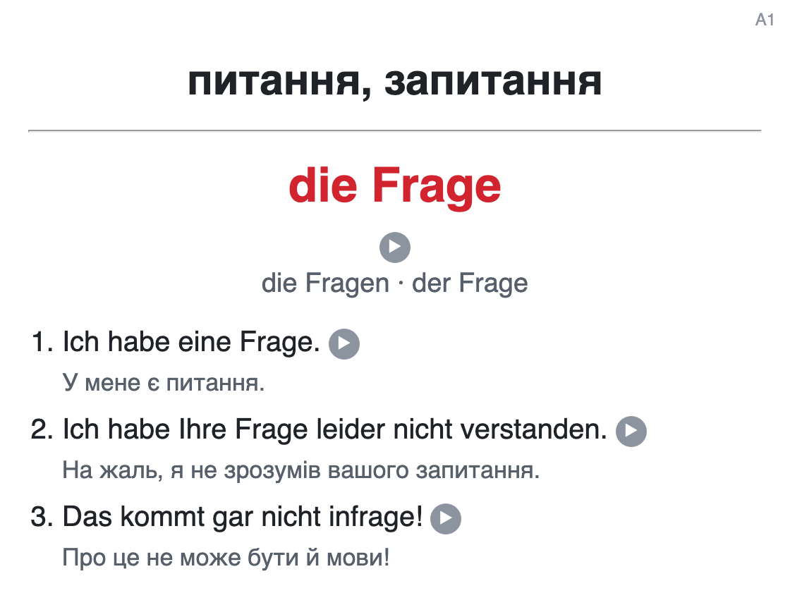

# Goethe A1–B1 Anki decks (DE ↔ RU / UK)

Anki decks with the complete vocabulary of the official Goethe-Institut word lists
([Start Deutsch 1 / A1][a1], [Goethe-Zertifikat A2][a2], [Goethe-Zertifikat B1][b1]):
noun gender colours, plurals, genitive, verb forms, every official example sentence with
translation and German audio.

**⬇ [Download the latest release](https://github.com/lernen-deutsch/goethe-a1-b1-anki/releases/latest)** —
`Deutsch_Goethe_A1-B1_RU.apkg` (Russian) · `Deutsch_Goethe_A1-B1_UK.apkg` (Ukrainian).
Import: Anki → File → Import.

| DE → RU (back) | DE → RU (back, dark mode) |
|---|---|
|  |  |
| **RU → DE (front)** | **UK → DE (back)** |
|  |  |

> 🇷🇺 Колоды Anki со всем словарём официальных списков Goethe-Institut A1–B1: цвет рода,
> множественное число, генитив, формы глаголов, все официальные примеры с переводом и озвучкой.
>
> 🇺🇦 Колоди Anki з усією лексикою офіційних списків Goethe-Institut A1–B1: колір роду,
> множина, генітив, форми дієслів, усі офіційні приклади з перекладом та озвученням.

This is an unofficial, non-commercial study project and is not affiliated with or endorsed by
the Goethe-Institut. See [Sources and licences](#sources-and-licences).

## Decks

Two independent packages with the same German content:

| Package | Deck | Translation |
|---|---|---|
| `dist/Deutsch_Goethe_A1-B1_RU.apkg` | `Deutsch Goethe A1–B1 (RU)` | Russian |
| `dist/Deutsch_Goethe_A1-B1_UK.apkg` | `Deutsch Goethe A1–B1 (UK)` | Ukrainian |

They use different deck/model IDs and note GUIDs, so both can be imported side by side.
Each deck has three sub-decks:

| Sub-deck | Front/back content |
|---|---|
| `1 Nomen` | article + noun coloured by gender (**der** blue, **die** red, **das** green), full plural, genitive singular, feminine form, regional variants |
| `2 Verben` | infinitive (`*` = strong/irregular), 3rd person singular, Präteritum, `hat`/`ist` + Partizip II |
| `3 Andere` | adjectives, adverbs, prepositions, phrases, word-formation prefixes |

Every note has two cards:

* **RU/UK → DE** — front: translated word + translations of all examples; back: German word, forms and the examples (DE + translation) with audio.
* **DE → RU/UK** — front: German word + German examples with audio; back: forms, translated word, examples with translations.

All official example sentences are included (merged across levels, duplicates removed).
German audio (word and every example) is synthesised locally with [Piper](https://github.com/OHF-Voice/piper1-gpl)
(`de_DE-thorsten-low`), encoded as mono MP3 so it plays on Anki Desktop, AnkiDroid and AnkiMobile.
Tags: `goethe`, `A1`/`A2`/`B1` (every level the word appears in), `pos::noun|verb|other`.
New cards are ordered A1 → A2 → B1. Note GUIDs are stable, so re-importing an updated package updates notes in place.

## Build

Requires [uv](https://docs.astral.sh/uv/) (Python 3.12 is pinned in `.python-version`).

```sh
uv sync
uv run mc download   # Goethe PDFs + kaikki.org German dump (~1.1 GB) into cache/
uv run mc parse      # PDFs + Wiktionary forms -> data/entries.json, data/parse_report.json
uv run mc batches --lang uk   # (only if translations are missing) -> data/translations/uk/todo/*.input.json
uv run mc validate --lang ru  # every entry has a word translation + one sentence per DE example
uv run mc validate --lang uk
uv run mc tts                 # Piper -> cache/audio/*.mp3 (idempotent, content-hashed file names)
uv run mc build --lang ru     # -> dist/Deutsch_Goethe_A1-B1_RU.apkg
uv run mc build --lang uk     # -> dist/Deutsch_Goethe_A1-B1_UK.apkg
uv run mc screenshots         # -> docs/screenshots/*.png (needs Chrome)
uv run pytest
```

## Pipeline

1. `parse_goethe.py` — reads the PDFs character by character with pdfplumber and splits each
   page into headword/example columns by x position (two columns per page for A2/B1).
   Wrapped headwords, wrapped verb forms, feminine forms sharing an example, numbered B1
   examples and sentences broken across columns are reassembled heuristically.
2. `data/fixes.json` — manual corrections for the few layout/typo cases heuristics cannot resolve.
3. `entries.py` — classifies noun/verb/other, merges the three levels (lowest level wins,
   examples are unioned) and enriches grammar from Wiktionary via the
   [kaikki.org](https://kaikki.org/dictionary/German/) extract: genitive, missing plurals,
   missing verb forms, auxiliary, and verb class (strong/irregular → `*`). Goethe data takes
   priority; disagreements are listed in `data/parse_report.json`.
4. `data/translations/<lang>/` — Russian (`ru`) and Ukrainian (`uk`) translations
   (see `GUIDELINES.md`), one JSON file per batch, keyed by entry id. Later batch files override
   earlier ones. They are machine-assisted and should be spot-checked. Adding a language:
   register it in `translations.LANGS` and `build_deck.LANG_CONFIG`, then `mc batches --lang <code>`.
5. `tts.py`, `build_deck.py` — audio and package assembly with genanki.

Not included: the thematic "Wortgruppen" lists (numbers, countries, …) at the start of each PDF,
which have no example sentences.

## Sources and licences

**Vocabulary and example sentences** — official word lists of the Goethe-Institut e.V.
(Goethe-Institut e.V., Dachauer Straße 122, 80637 München):

| Level | Exam | Word list (PDF) |
|---|---|---|
| A1 | Goethe-Zertifikat A1: Start Deutsch 1 | [A1_SD1_Wortliste_02.pdf][a1] |
| A2 | Goethe-Zertifikat A2 | [Goethe-Zertifikat_A2_Wortliste.pdf][a2] |
| B1 | Goethe-Zertifikat B1 (Goethe-Institut, ÖSD, Universität Freiburg) | [Goethe-Zertifikat_B1_Wortliste.pdf][b1] |

Exam information: <https://www.goethe.de/de/spr/prf.html>.
The word lists are © Goethe-Institut e.V. The PDFs are not stored in this repository; `mc download`
fetches them from goethe.de. Headwords and example sentences extracted from them (`data/entries.json`)
are used here for non-commercial personal study only. If you are a rights holder and object to this use,
please open an issue and the material will be removed.

**Other sources**

* Grammar (genitive, missing plurals and verb forms, verb class): [Wiktionary](https://de.wiktionary.org/)
  via the [kaikki.org](https://kaikki.org/dictionary/German/) Wiktextract dump — CC BY-SA 4.0.
* Russian and Ukrainian translations: machine-assisted, part of this project.
* Audio: [Piper TTS](https://github.com/OHF-Voice/piper1-gpl) (GPL-3.0), voice
  [`de_DE-thorsten-low`](https://huggingface.co/rhasspy/piper-voices/tree/main/de/de_DE/thorsten/low)
  by Thorsten Müller — CC0.

Each deck also carries these source links in its Anki deck description.

[a1]: https://www.goethe.de/pro/relaunch/prf/de/A1_SD1_Wortliste_02.pdf
[a2]: https://www.goethe.de/pro/relaunch/prf/de/Goethe-Zertifikat_A2_Wortliste.pdf
[b1]: https://www.goethe.de/pro/relaunch/prf/de/Goethe-Zertifikat_B1_Wortliste.pdf
