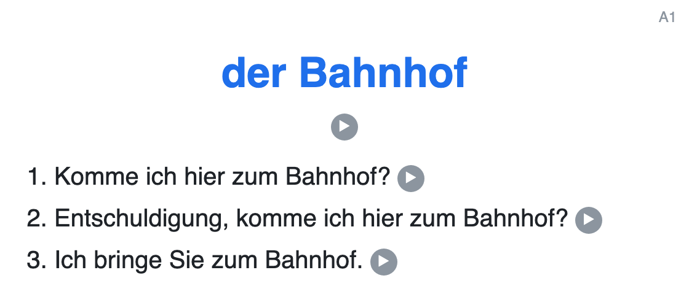
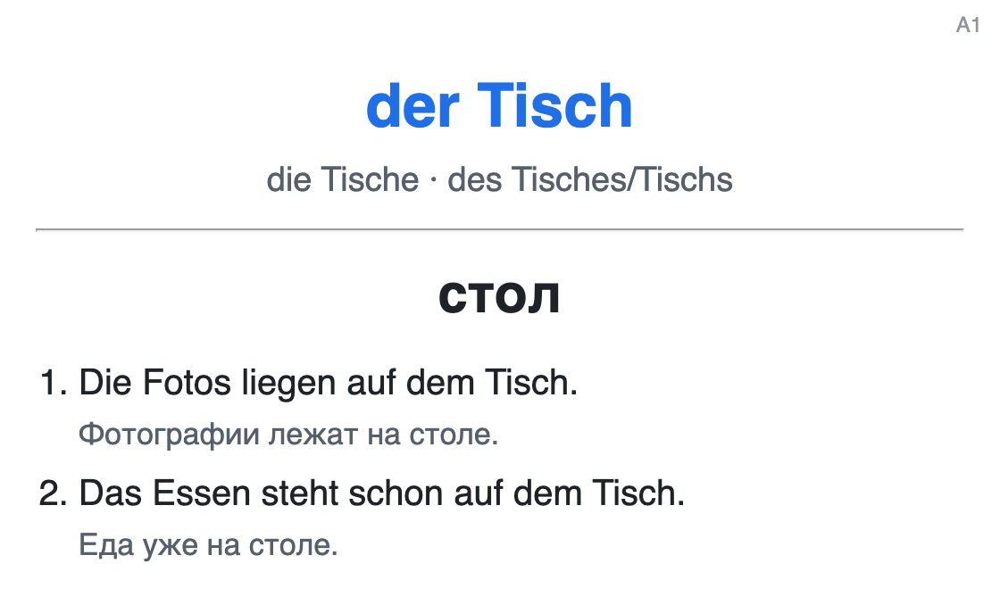
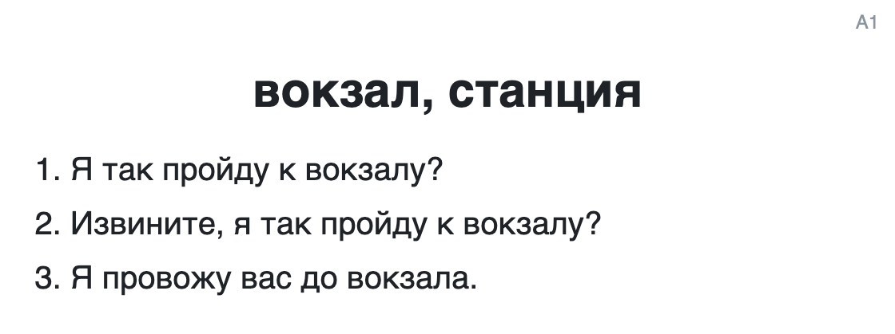
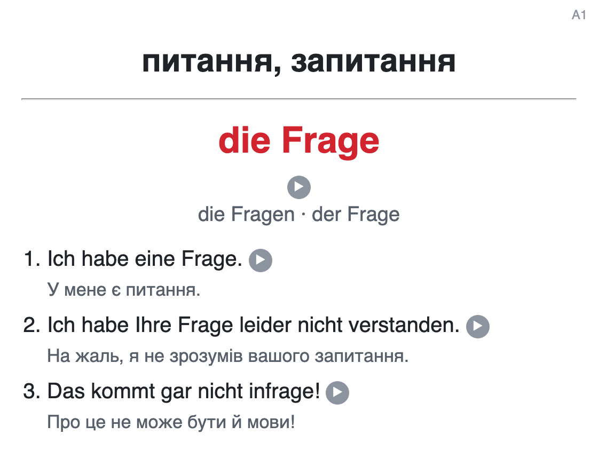
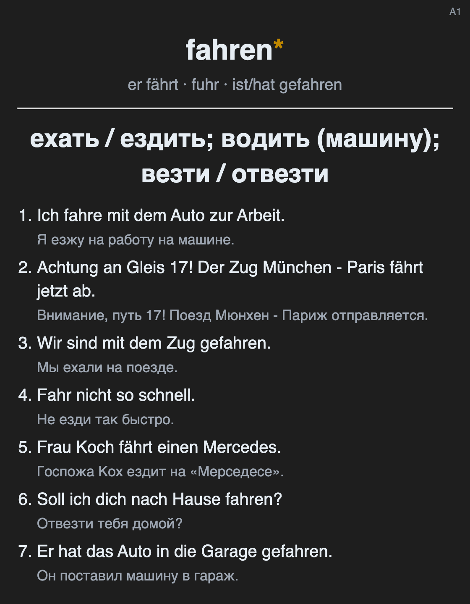
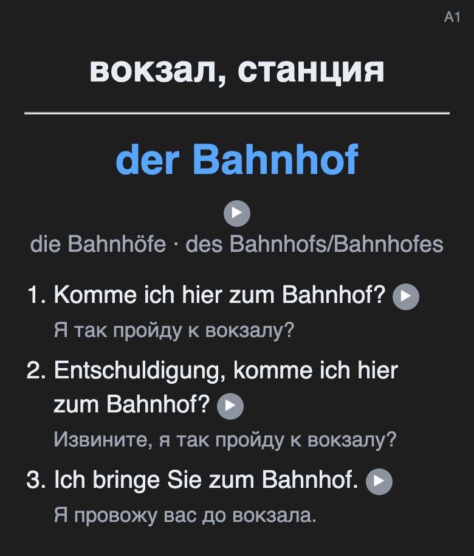

# Колоды Anki Goethe A1–B1 (DE ↔ RU / UK)

[English](README.md) · [Deutsch](README.de.md) · [Українська](README.uk.md) · **Русский**

Колоды Anki со всей лексикой официальных списков слов Goethe-Institut
([Start Deutsch 1 / A1][a1], [Goethe-Zertifikat A2][a2], [Goethe-Zertifikat B1][b1]):
цвет рода, множественное число, генитив, формы глаголов и все официальные примеры
с переводом и немецкой озвучкой.

**⬇ [Скачать последнюю версию](https://github.com/gemeinsam-deutsch-lernen/goethe-a1-b1-anki/releases/latest)** —
`Deutsch_Goethe_A1-B1_RU.apkg` (русский) · `Deutsch_Goethe_A1-B1_UK.apkg` (украинский).
Импорт: Anki → Файл → Импорт.

## Что такое Anki?

[Anki](https://apps.ankiweb.net/) — бесплатное приложение для карточек с **интервальным повторением**:
каждая карточка возвращается прямо перед тем, как вы её забыли бы, поэтому нескольких минут в день
хватает, чтобы надолго удерживать в памяти тысячи слов
([как это работает](https://docs.ankiweb.net/background.html)).

| Платформа | Приложение | Цена |
|---|---|---|
| Windows, macOS, Linux | [Anki Desktop](https://apps.ankiweb.net/) | бесплатно |
| Android | [AnkiDroid](https://play.google.com/store/apps/details?id=com.ichi2.anki) ([F-Droid](https://f-droid.org/packages/com.ichi2.anki/)) | бесплатно |
| iPhone, iPad | [AnkiMobile](https://apps.apple.com/app/ankimobile-flashcards/id373493387) | платно (финансирует разработку Anki) |
| Браузер | [AnkiWeb](https://ankiweb.net/) — бесплатная синхронизация между устройствами, занятия в браузере | бесплатно |

Руководство: <https://docs.ankiweb.net/>.

## Как начать

1. Установите Anki (см. выше).
2. Скачайте `Deutsch_Goethe_A1-B1_RU.apkg` или `Deutsch_Goethe_A1-B1_UK.apkg` из
   [последней версии](https://github.com/gemeinsam-deutsch-lernen/goethe-a1-b1-anki/releases/latest).
3. Откройте файл: двойным щелчком на компьютере или через *Файл → Импорт* в Anki; на Android/iOS —
   в AnkiDroid/AnkiMobile ([импорт колод](https://docs.ankiweb.net/importing/packaged-decks.html)).
4. По желанию: включите синхронизацию с бесплатным аккаунтом AnkiWeb, чтобы заниматься на всех устройствах.
5. Задайте темп в [параметрах колоды](https://docs.ankiweb.net/deck-options.html).
   Пример для **3 слов в день** (одно существительное, один глагол, одно другое слово, каждое в обе стороны):
   * подколоды `1 Nomen`, `2 Verben`, `3 Andere`: *Новых карточек в день* = 2, *Порядок сбора новых карточек* = По возрастанию позиции;
   * родительская колода: *Новых карточек в день* = 6, *Порядок сбора новых карточек* = Колода.

Новые карточки идут в порядке A1 → A2 → B1. Новую версию можно спокойно импортировать поверх старой —
история повторений сохранится.

## Скриншоты

| Немецкий → перевод (лицевая сторона) | Немецкий → перевод (оборот) |
|---|---|
|  |  |
| **Перевод → немецкий (лицевая сторона)** | **Украинская колода (оборот)** |
|  |  |
| **Формы глагола, тёмная тема** | **Телефон, тёмная тема** |
|  |  |

Кнопки ▶ проигрывают немецкое произношение слова и каждого примера.

## Колоды

| Файл | Колода | Перевод |
|---|---|---|
| `Deutsch_Goethe_A1-B1_RU.apkg` | `Deutsch Goethe A1–B1 (RU)` | русский |
| `Deutsch_Goethe_A1-B1_UK.apkg` | `Deutsch Goethe A1–B1 (UK)` | украинский |

Немецкое содержимое у обеих колод одинаковое, их можно использовать одновременно. В каждой три подколоды:

| Подколода | Содержимое |
|---|---|
| `1 Nomen` | артикль + существительное в цвете рода (**der** синий, **die** красный, **das** зелёный), множественное число, генитив, женская форма, региональные варианты |
| `2 Verben` | инфинитив (`*` = сильный/неправильный), 3-е лицо ед. ч., Präteritum, `hat`/`ist` + Partizip II |
| `3 Andere` | прилагательные, наречия, предлоги, выражения, словообразовательные приставки |

У каждой записи две карточки:

* **Перевод → DE** — лицевая сторона: слово на русском/украинском + переводы всех примеров; оборот: немецкое слово, формы и примеры (DE + перевод) с озвучкой.
* **DE → перевод** — лицевая сторона: немецкое слово + немецкие примеры с озвучкой; оборот: формы, перевод, примеры с переводами.

Включены все официальные примеры. Немецкая озвучка синтезирована локально с помощью
[Piper](https://github.com/OHF-Voice/piper1-gpl) (`de_DE-thorsten-low`) в формате MP3 — работает
в Anki Desktop, AnkiDroid и AnkiMobile.
Теги: `goethe`, `A1`/`A2`/`B1`, `pos::noun|verb|other`.

Переводы сделаны с помощью машинного перевода; об ошибках пишите в [Issues](https://github.com/gemeinsam-deutsch-lernen/goethe-a1-b1-anki/issues).

Самостоятельная сборка и технические подробности: [Build](README.md#build) и [Pipeline](README.md#pipeline) (на английском).

## Источники и лицензии

**Лексика и примеры** — официальные списки слов Goethe-Institut e.V.
(Goethe-Institut e.V., Dachauer Straße 122, 80637 München):

| Уровень | Экзамен | Список слов (PDF) |
|---|---|---|
| A1 | Goethe-Zertifikat A1: Start Deutsch 1 | [A1_SD1_Wortliste_02.pdf][a1] |
| A2 | Goethe-Zertifikat A2 | [Goethe-Zertifikat_A2_Wortliste.pdf][a2] |
| B1 | Goethe-Zertifikat B1 (Goethe-Institut, ÖSD, Universität Freiburg) | [Goethe-Zertifikat_B1_Wortliste.pdf][b1] |

Об экзаменах: <https://www.goethe.de/de/spr/prf.html>.
Списки слов © Goethe-Institut e.V. Сами PDF в репозитории не хранятся. Извлечённые из них слова
и примеры используются только для некоммерческого изучения языка. Если вы правообладатель и
возражаете против такого использования, откройте issue — материал будет удалён.

**Другие источники**

* Грамматика (генитив, недостающие формы мн. ч. и глаголов, тип глагола): [Wiktionary](https://de.wiktionary.org/)
  через выгрузку Wiktextract с [kaikki.org](https://kaikki.org/dictionary/German/) — CC BY-SA 4.0.
* Русский и украинский переводы: машинный перевод, часть этого проекта.
* Озвучка: [Piper TTS](https://github.com/OHF-Voice/piper1-gpl) (GPL-3.0), голос
  [`de_DE-thorsten-low`](https://huggingface.co/rhasspy/piper-voices/tree/main/de/de_DE/thorsten/low)
  Торстена Мюллера — CC0.

Это неофициальный некоммерческий учебный проект, не связанный с Goethe-Institut и не одобренный им.

[a1]: https://www.goethe.de/pro/relaunch/prf/de/A1_SD1_Wortliste_02.pdf
[a2]: https://www.goethe.de/pro/relaunch/prf/de/Goethe-Zertifikat_A2_Wortliste.pdf
[b1]: https://www.goethe.de/pro/relaunch/prf/de/Goethe-Zertifikat_B1_Wortliste.pdf
