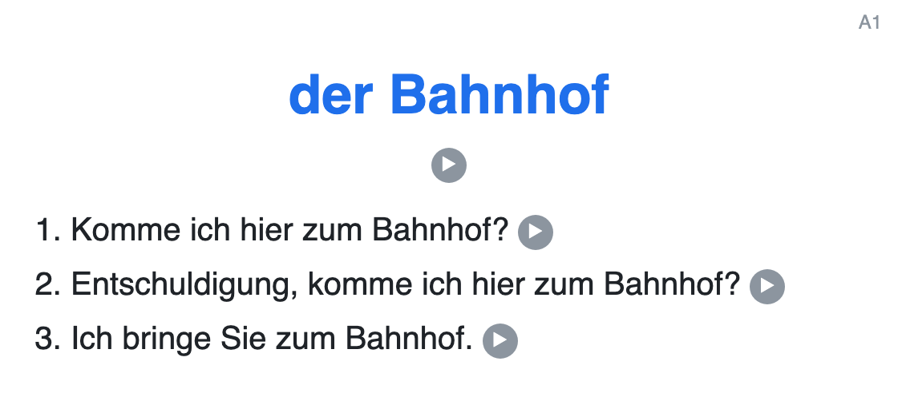
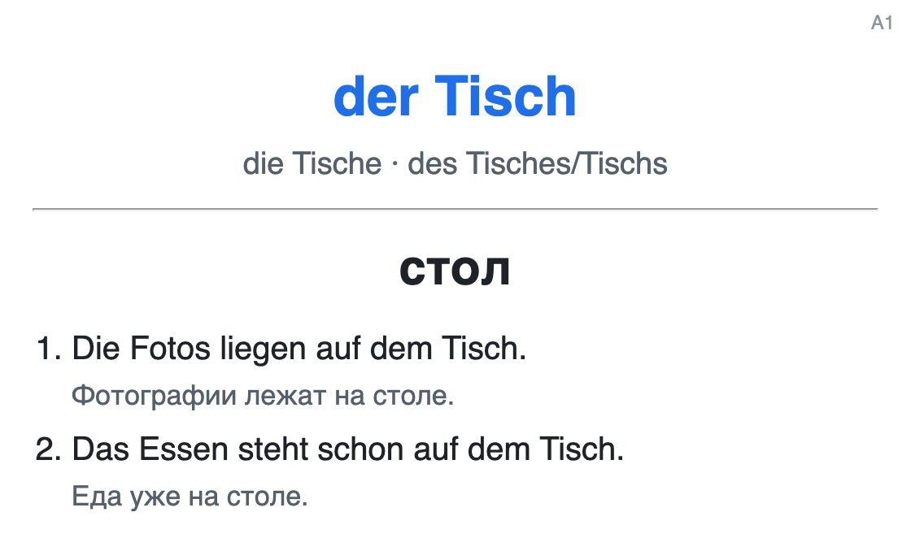
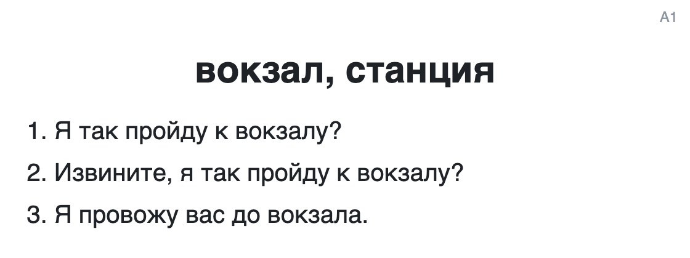
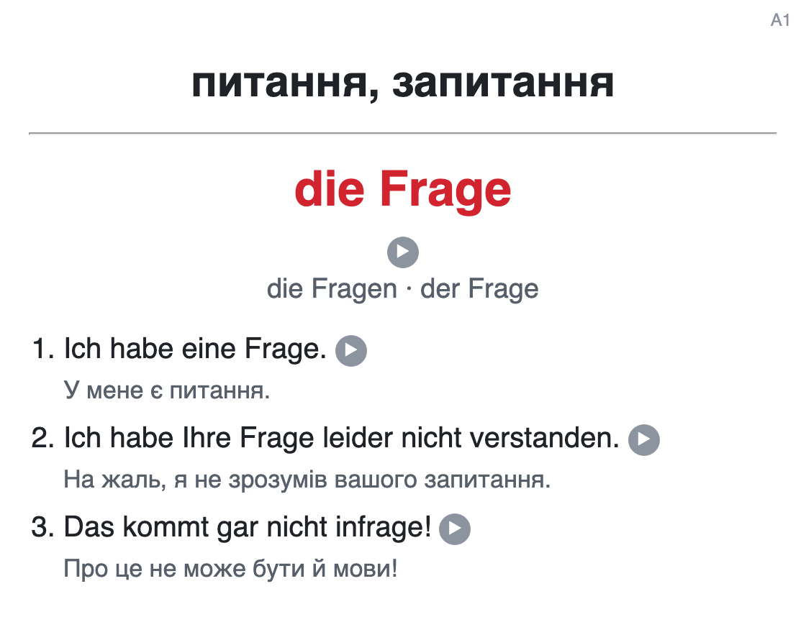
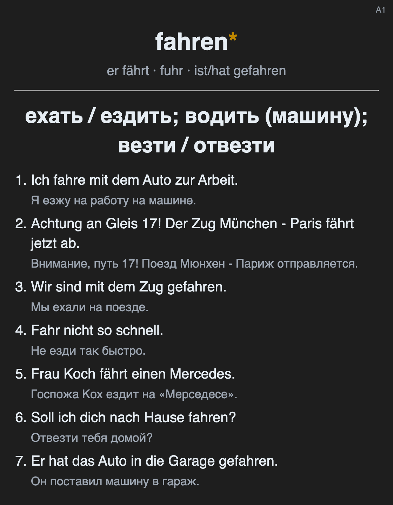
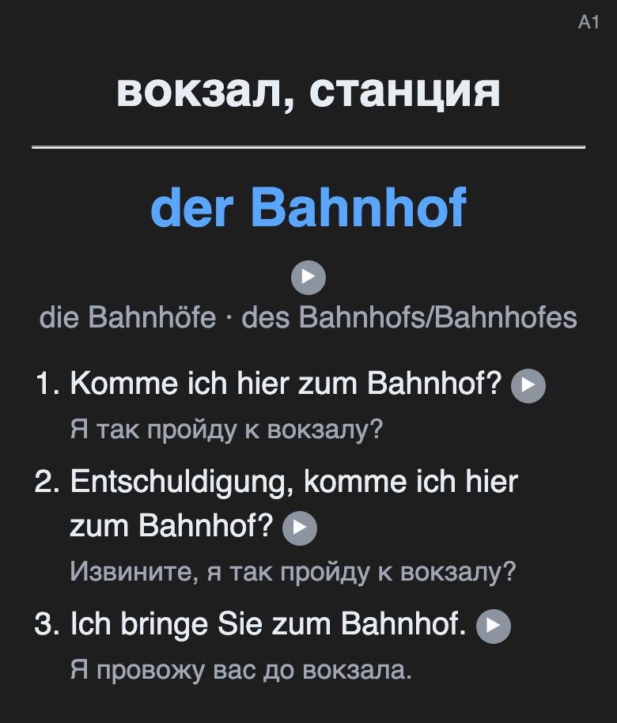

# Колоди Anki Goethe A1–B1 (DE ↔ RU / UK)

[English](README.md) · [Deutsch](README.de.md) · **Українська** · [Русский](README.ru.md)

Колоди Anki з усією лексикою офіційних списків слів Goethe-Institut
([Start Deutsch 1 / A1][a1], [Goethe-Zertifikat A2][a2], [Goethe-Zertifikat B1][b1]):
колір роду, множина, генітив, форми дієслів і всі офіційні приклади з перекладом
та німецьким озвученням.

**⬇ [Завантажити останню версію](https://github.com/gemeinsam-deutsch-lernen/goethe-a1-b1-anki/releases/latest)** —
`Deutsch_Goethe_A1-B1_UK.apkg` (українська) · `Deutsch_Goethe_A1-B1_RU.apkg` (російська).
Імпорт: Anki → Файл → Імпорт.

## Що таке Anki?

[Anki](https://apps.ankiweb.net/) — безкоштовний застосунок для карток з **інтервальним повторенням**:
кожна картка повертається саме перед тим, як ви б її забули, тож кількох хвилин на день
достатньо, щоб надовго запам'ятати тисячі слів
([як це працює](https://docs.ankiweb.net/background.html)).

| Платформа | Застосунок | Ціна |
|---|---|---|
| Windows, macOS, Linux | [Anki Desktop](https://apps.ankiweb.net/) | безкоштовно |
| Android | [AnkiDroid](https://play.google.com/store/apps/details?id=com.ichi2.anki) ([F-Droid](https://f-droid.org/packages/com.ichi2.anki/)) | безкоштовно |
| iPhone, iPad | [AnkiMobile](https://apps.apple.com/app/ankimobile-flashcards/id373493387) | платно (фінансує розробку Anki) |
| Браузер | [AnkiWeb](https://ankiweb.net/) — безкоштовна синхронізація між пристроями, заняття в браузері | безкоштовно |

Посібник: <https://docs.ankiweb.net/>.

## Як почати

1. Встановіть Anki (див. вище).
2. Завантажте `Deutsch_Goethe_A1-B1_UK.apkg` або `Deutsch_Goethe_A1-B1_RU.apkg` з
   [останньої версії](https://github.com/gemeinsam-deutsch-lernen/goethe-a1-b1-anki/releases/latest).
3. Відкрийте файл: подвійним клацанням на комп'ютері або через *Файл → Імпорт* в Anki; на Android/iOS —
   в AnkiDroid/AnkiMobile ([імпорт колод](https://docs.ankiweb.net/importing/packaged-decks.html)).
4. За бажанням: увімкніть синхронізацію з безкоштовним акаунтом AnkiWeb, щоб навчатися на всіх пристроях.
5. Задайте темп у [параметрах колоди](https://docs.ankiweb.net/deck-options.html).
   Приклад для **4 слів на день** (один іменник, одне слабке дієслово, одне сильне дієслово, одне інше слово, кожне в обидва боки):
   * підколоди `1 Nomen`, `2 Verben`, `2 Verben stark`, `3 Andere`: *Нових карток на день* = 2, *Порядок збору нових карток* = За зростанням позиції;
   * батьківська колода: *Нових карток на день* = 8, *Порядок збору нових карток* = Колода.

   Щоб змінювати темп `2 Verben stark` окремо, дайте цій підколоді власний набір параметрів.

Нові картки йдуть у порядку A1 → A2 → B1. Нову версію можна спокійно імпортувати поверх старої —
історія повторень збережеться.

**Оновлення з v0.1.3 і старіших:** Anki залишає наявні картки в їхній колоді, тому сильні дієслова
залишаться в `2 Verben`. Перенести їх один раз: *Огляд* → пошук `tag:verb::strong` → виділити всі →
*Картки → Змінити колоду* → `2 Verben stark`.

## Знімки екрана

| Німецька → переклад (лицьовий бік) | Німецька → переклад (зворот) |
|---|---|
|  |  |
| **Переклад → німецька (лицьовий бік)** | **Українська колода (зворот)** |
|  |  |
| **Форми дієслова, темна тема** | **Телефон, темна тема** |
|  |  |

Кнопки ▶ відтворюють німецьку вимову слова та кожного прикладу.

## Колоди

| Файл | Колода | Переклад |
|---|---|---|
| `Deutsch_Goethe_A1-B1_UK.apkg` | `Deutsch Goethe A1–B1 (UK)` | українська |
| `Deutsch_Goethe_A1-B1_RU.apkg` | `Deutsch Goethe A1–B1 (RU)` | російська |

Німецький вміст в обох колодах однаковий, їх можна використовувати одночасно. У кожній чотири підколоди:

| Підколода | Вміст |
|---|---|
| `1 Nomen` | артикль + іменник у кольорі роду (**der** синій, **die** червоний, **das** зелений), множина, генітив, жіноча форма, регіональні варіанти |
| `2 Verben` | слабкі дієслова: інфінітив, 3-тя особа одн., Präteritum, `hat`/`ist` + Partizip II |
| `2 Verben stark` | сильні/неправильні дієслова (`*`), ті самі форми — окрема підколода з власним денним лімітом |
| `3 Andere` | прикметники, прислівники, прийменники, вирази, словотвірні префікси |

Кожен запис має дві картки:

* **Переклад → DE** — лицьовий бік: слово українською + переклади всіх прикладів; зворот: німецьке слово, форми та приклади (DE + переклад) з озвученням.
* **DE → переклад** — лицьовий бік: німецьке слово + німецькі приклади з озвученням; зворот: форми, переклад, приклади з перекладами.

Включено всі офіційні приклади. Німецьке озвучення синтезовано локально за допомогою
[Piper](https://github.com/OHF-Voice/piper1-gpl) (`de_DE-thorsten-low`) у форматі MP3 — працює
в Anki Desktop, AnkiDroid і AnkiMobile.
Теги: `goethe`, `A1`/`A2`/`B1`, `pos::noun|verb|other`, `verb::strong`.

Переклади зроблено за допомогою машинного перекладу; про помилки пишіть в [Issues](https://github.com/gemeinsam-deutsch-lernen/goethe-a1-b1-anki/issues).

Самостійне збирання та технічні подробиці: [Build](README.md#build) і [Pipeline](README.md#pipeline) (англійською).

## Джерела та ліцензії

**Лексика та приклади** — офіційні списки слів Goethe-Institut e.V.
(Goethe-Institut e.V., Dachauer Straße 122, 80637 München):

| Рівень | Іспит | Список слів (PDF) |
|---|---|---|
| A1 | Goethe-Zertifikat A1: Start Deutsch 1 | [A1_SD1_Wortliste_02.pdf][a1] |
| A2 | Goethe-Zertifikat A2 | [Goethe-Zertifikat_A2_Wortliste.pdf][a2] |
| B1 | Goethe-Zertifikat B1 (Goethe-Institut, ÖSD, Universität Freiburg) | [Goethe-Zertifikat_B1_Wortliste.pdf][b1] |

Про іспити: <https://www.goethe.de/de/spr/prf.html>.
Списки слів © Goethe-Institut e.V. Самі PDF у репозиторії не зберігаються. Взяті з них слова
та приклади використовуються лише для некомерційного вивчення мови. Якщо ви правовласник і
заперечуєте проти такого використання, відкрийте issue — матеріал буде видалено.

**Інші джерела**

* Граматика (генітив, відсутні форми множини та дієслів, тип дієслова): [Wiktionary](https://de.wiktionary.org/)
  через вивантаження Wiktextract з [kaikki.org](https://kaikki.org/dictionary/German/) — CC BY-SA 4.0.
* Український та російський переклади: машинний переклад, частина цього проєкту.
* Озвучення: [Piper TTS](https://github.com/OHF-Voice/piper1-gpl) (GPL-3.0), голос
  [`de_DE-thorsten-low`](https://huggingface.co/rhasspy/piper-voices/tree/main/de/de_DE/thorsten/low)
  Торстена Мюллера — CC0.

Це неофіційний некомерційний навчальний проєкт, не пов'язаний з Goethe-Institut і не схвалений ним.

[a1]: https://www.goethe.de/pro/relaunch/prf/de/A1_SD1_Wortliste_02.pdf
[a2]: https://www.goethe.de/pro/relaunch/prf/de/Goethe-Zertifikat_A2_Wortliste.pdf
[b1]: https://www.goethe.de/pro/relaunch/prf/de/Goethe-Zertifikat_B1_Wortliste.pdf
